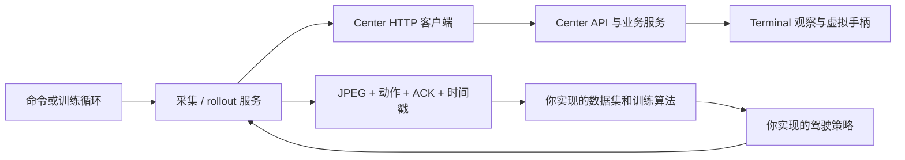

# 自动驾驶 AI 训练框架

本目录是独立的 uv 项目，保留原来的 PyTorch/CUDA 环境和 `src/model/` 模型骨架。已经实现 Center 客户端、图像采集、数据记录和中立策略交互；模型、图像预处理、训练算法、奖励与评估由你实现。所有新增模块的注释均为中文。

## 目录与调用关系

```text
AI/
├── pyproject.toml                 独立依赖、CUDA 源和命令入口
├── uv.lock
├── .env.example                   Center 连接配置示例
├── check_env.py                   原有 CUDA 环境检查
├── src/
│   ├── cli/                       解析命令行，再调用业务服务
│   ├── config/                    加载 AI/.env，校验连接和实验参数
│   ├── domain/                    Action、Observation、StepResult
│   ├── integrations/center/       HTTP/Bearer 适配，不导入 center 代码
│   ├── services/
│   │   ├── sessions.py            选取终端并检查连接会话
│   │   ├── collection.py          只读采集新鲜观察图像
│   │   └── rollout.py             观察 → 策略 → step → 记录 → 释放
│   ├── data/
│   │   ├── recorder.py            保存 JPEG、JSONL 和 episode 元数据
│   │   ├── dataset.py             TODO：离线数据索引和序列样本
│   │   └── preprocessing.py       TODO：训练与推理共享的图像处理
│   ├── model/                     原有视觉 Transformer，具体计算待实现
│   ├── policies/
│   │   ├── base.py                策略 predict 接口
│   │   ├── neutral.py             中立动作，仅用于链路联调
│   │   └── driving.py             TODO：权重加载、模型推理、动作映射
│   ├── environments/              强化学习环境协议，重置逻辑待实现
│   ├── training/
│   │   ├── bc.py                  TODO：行为克隆训练
│   │   ├── rl.py                  TODO：强化学习训练
│   │   └── reward.py              TODO：奖励与终止信号
│   └── evaluation/                TODO：评估场景、指标和结果统计
├── examples/center_roundtrip.py    最小 Center 交互示例
├── docs/
│   ├── data-format.md             数据字段、标签来源和会话边界
│   └── implementation-guide.md    建议实现顺序与训练约束
└── tests/                         本地模拟中心、记录器和业务流程验证
```



AI 获取带时间戳的 JPEG 观察，不从浏览器 WebRTC 视频里抓图；WebRTC 继续供人查看驾驶画面。AI 不需要启动游戏采集驱动，也不直接操作 ViGEmBus。Center 与 Terminal 的部署见各自目录说明。

## uv 环境与连接配置

在 AI 目录执行：

```powershell
uv sync --locked
Copy-Item .env.example .env
# 编辑 .env：CENTER_TOKEN 与 center/.env 一致，CENTER_URL 为可访问的中心地址。
uv run auto-driver-ai --help
uv run auto-driver-ai terminals
```

`.env` 自动按 AI 目录定位，进程环境变量优先。多终端时设置 `AI_TERMINAL_ID=game-pc`，或在子命令前传 `--terminal-id game-pc`。未指定时，要求恰好一个在线终端。此项目保留原来的 GPU 依赖；`uv run python check_env.py` 检查 PyTorch/CUDA。

```dotenv
CENTER_URL=http://127.0.0.1:8000
CENTER_TOKEN=与中心相同的配对口令
AI_TERMINAL_ID=game-pc
AI_OBSERVATION_TIMEOUT=5
AI_ACTION_DURATION_MS=100
AI_DATA_DIR=data
```

## 获取训练数据

保存单张观察图像：

```powershell
uv run auto-driver-ai --terminal-id game-pc observe --output data/preview.jpg
```

只读采集一段图片序列：

```powershell
uv run auto-driver-ai --terminal-id game-pc collect --frames 100 --output data/session-01
```

`collect` 不发送动作或释放指令，适合人工驾驶时收集画面。它通过 `after` 帧游标等待新图像，保存 JPEG、采集时间、中心接收时间和连接会话。每次运行在输出目录下创建唯一的 `episode-.../`，不会覆盖旧数据；省略 `--output` 时使用 `AI_DATA_DIR` 下自动命名的目录。

这些图像是**无标签数据**。Center 当前没有逐帧人工驾驶标签接口，不能从截图或每五秒上报的手柄状态得到准确的示范动作。行为克隆还需你实现示范操作记录或人工标注。数据格式和标签来源见 [data-format.md](docs/data-format.md)。

## 通过 Center 发送指令

```python
import asyncio

from src.config import Settings
from src.domain import Action
from src.integrations.center import CenterClient


async def main():
    settings = Settings.from_env()
    terminal_id = settings.terminal_id or "game-pc"
    async with CenterClient(settings.base_url, settings.token) as client:
        try:
            observation = await client.observe(terminal_id)
            # 在这里：图像预处理 → 你的模型 → Action。
            action = Action(steering=0.1, throttle=0.2, brake=0.0, duration_ms=100)
            result = await client.step(terminal_id, action)
            next_observation = result.observation
            print(observation.sequence, result.command_id, next_observation.sequence)
        finally:
            await client.release(terminal_id)


asyncio.run(main())
```

| 客户端方法 | Center 路径 | 返回或作用 |
| --- | --- | --- |
| `list_terminals()` | `GET /api/terminals` | 终端状态和连接会话 |
| `get_terminal(id)` | `GET /api/terminals/{id}` | 检查指定终端和会话 |
| `observe(id, after=序号)` | `GET /api/terminals/{id}/frame` | 更新的 JPEG 和时间戳 |
| `action(id, action)` | `POST /api/terminals/{id}/actions` | 执行动作并等待 ACK |
| `step(id, action)` | `POST /api/terminals/{id}/step` | ACK 与动作保持时段后的图像 |
| `release(id)` | `POST /api/terminals/{id}/release` | 释放全部输入并取消此前操作 |

每次 Action 完整替换手柄状态，未填写的轴归零、按钮释放。转向范围 `[-1, 1]`，油门和刹车 `[0, 1]`；按钮用元组，例如 `buttons=("A",)`。`duration_ms` 为 0–5000 毫秒，0 表示立即释放。ACK 代表驱动执行确认，不代表车辆已完成预期动作。网络异常后 POST 不会自动重试，避免动作被执行两次。

中立策略交互会真实调用所选终端的 step，但不主动加油：

```powershell
uv run auto-driver-ai --terminal-id game-pc rollout --policy neutral --steps 5 --output data/rollout-01
uv run python -m examples.center_roundtrip
```

rollout 保存当前观察、策略提出的动作、命令 ID、ACK 和后续观察，结束、错误或取消时请求释放输入。它只验证接入流程，不提供可用驾驶策略。后续可以把 `NeutralPolicy` 换成你实现的 `DrivingPolicy`。

## 留给你实现的训练部分

建议先完成数据集、预处理、现有视觉模型及动作头，再实现行为克隆，最后接入奖励和强化学习。训练入口已预留：

```powershell
uv run auto-driver-ai train-bc --dataset data --output runs/bc --epochs 10
uv run auto-driver-ai train-rl --output runs/rl --total-steps 10000
```

目前这两个命令会明确报告待实现的训练流程，不会启动占位训练。训练数据按 episode 划分训练集和验证集；无标签图片与中立动作记录都不能当成合格的人类驾驶示范。

Center 只提供控制和观察，不提供车速/碰撞遥测、奖励、终止或重置比赛；相关框架接口位于 `environments/`、`training/reward.py` 和 `evaluation/`。默认训练观察 10 FPS，由 Terminal 的 `TERMINAL_OBSERVATION_FPS` 独立配置，不等同于视频播放 60/120 FPS。

具体待实现清单见 [implementation-guide.md](docs/implementation-guide.md)，原有模型约定见 [模型说明](src/model/README.md)。

## 验证框架

```powershell
uv run python -m unittest discover -s tests -v
```

测试通过本地模拟 Center 和临时数据目录验证协议、记录格式与异常释放，不向真实游戏终端发送操作。
