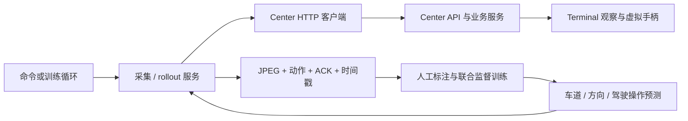

# 自动驾驶 AI 训练框架

本目录是独立的 uv 项目，使用 PyTorch/CUDA，通过 Center 获取游戏画面和已确认的驾驶输入。已实现采集、浏览器标注、共享预处理、视觉 Transformer、多任务训练、权重恢复，以及在线预测显示和驾驶执行。模型同时学习左右车道边界、转向类别、转向力度、油门、刹车和手柄按钮；不需要在 AI 电脑上安装采集或虚拟手柄驱动。

从没有数据开始，先按下面的流程采集和标注真实画面。代码可运行不代表模型已学会驾驶；合成数据只用于检查训练流程。

## 目录与调用关系

```text
AI/
├── pyproject.toml                 独立依赖、CUDA 源和命令入口
├── uv.lock
├── .env.example                   Center 连接配置示例
├── check_env.py                   原有 CUDA 环境检查
├── src/
│   ├── cli/                       解析命令行，再调用业务服务
│   ├── config/                    加载 AI/.env，校验连接和实验参数
│   ├── domain/                    Action、Observation、StepResult
│   ├── integrations/center/       HTTP/Bearer 适配，不导入 center 代码
│   ├── services/
│   │   ├── sessions.py            选取终端并检查连接会话
│   │   ├── collection.py          只读采集新鲜观察图像
│   │   ├── training_collection.py Center 画面与时间对齐的操作标签
│   │   ├── driving.py             模型预测 → 页面叠加 → 可选驾驶执行
│   │   └── rollout.py             策略交互记录与释放
│   ├── data/
│   │   ├── recorder.py            保存 JPEG、JSONL 和 episode 元数据
│   │   ├── dataset.py             标签校验、历史窗口及缺失标签掩码
│   │   ├── preprocessing.py       训练和推理共用 RGB 缩放
│   │   ├── annotations.py         本机浏览器车道与操作标注
│   │   └── synthetic.py           合成道路样本，验证训练流程
│   ├── model/                     视觉 Transformer 与五个任务输出头
│   ├── policies/
│   │   ├── base.py                策略 predict 接口
│   │   ├── neutral.py             中立动作，仅用于链路联调
│   │   └── driving.py             权重加载、车道/方向预测与操作映射
│   ├── environments/              强化学习环境协议，重置逻辑待实现
│   ├── training/
│   │   ├── bc.py                  车道/方向/操作联合监督训练
│   │   ├── rl.py                  TODO：强化学习训练
│   │   └── reward.py              TODO：奖励与终止信号
│   └── evaluation/                游戏场景评估扩展接口
├── examples/center_roundtrip.py    最小 Center 交互示例
├── docs/
│   ├── data-format.md             数据字段、标签来源和会话边界
│   └── implementation-guide.md    建议实现顺序与训练约束
└── tests/                         本地模拟中心、记录器和业务流程验证
```



AI 获取带时间戳的 JPEG 观察，不从浏览器 WebRTC 视频里抓图；WebRTC 继续供人查看驾驶画面。AI 不需要启动游戏采集驱动，也不直接操作 ViGEmBus。Center 与 Terminal 的部署见各自目录说明。

模型可通过 `CenterClient.publish_perception()` 将道路轮廓、中心线和预测转向发布到 Center，管理页会叠加在实时视频上；该方法只用于显示，不发送驾驶操作。`examples/publish_perception.py` 提供带“演示数据”标记的联调示例。字段和有效期见 [显示接口文档](../center/docs/perception.md)。

## uv 环境与连接配置

在 AI 目录执行：

```powershell
uv sync --locked
Copy-Item .env.example .env
# 编辑 .env：CENTER_TOKEN 与 center/.env 一致，CENTER_URL 为可访问的中心地址。
uv run auto-driver-ai --help
uv run auto-driver-ai terminals
```

`.env` 自动按 AI 目录定位，进程环境变量优先。多终端时设置 `AI_TERMINAL_ID=game-pc`，或在子命令前传 `--terminal-id game-pc`。未指定时，要求恰好一个在线终端。此项目保留原来的 GPU 依赖；`uv run python check_env.py` 检查 PyTorch/CUDA。

```dotenv
CENTER_URL=http://127.0.0.1:8000
CENTER_TOKEN=与中心相同的配对口令
AI_TERMINAL_ID=game-pc
AI_OBSERVATION_TIMEOUT=5
AI_ACTION_DURATION_MS=100
AI_DATA_DIR=data
```

## 获取训练数据

保存单张观察图像：

```powershell
uv run auto-driver-ai --terminal-id game-pc observe --output data/preview.jpg
```

只读采集一段图片序列：

```powershell
uv run auto-driver-ai --terminal-id game-pc collect --frames 100 --output data/session-01
```

`collect` 不发送动作或释放指令，适合人工驾驶时收集画面。它通过 `after` 帧游标等待新图像，保存 JPEG、采集时间、中心接收时间和连接会话。每次运行在输出目录下创建唯一的 `episode-.../`，不会覆盖旧数据；省略 `--output` 时使用 `AI_DATA_DIR` 下自动命名的目录。

`collect` 保存无标签 episode。训练应优先使用下面的 `collect-training`，它额外生成模型可直接读取的 `samples.jsonl`，并尝试匹配 Center 确认的驾驶操作。旧的无标签图片不会被自动补成零动作。

## 从 Center 获取数据、标注并训练

以下命令都在 `AI` 目录执行。若暂未配置 `AI/.env`，可在子命令前添加 `--env-file ../center/.env` 读取本机中心的配置。

```powershell
# 第一段驾驶片段。采集时在 Center 网页操作车辆；本命令只读取画面和状态。
uv run auto-driver-ai collect-training --frames 500 --output data/driving
# 换一段路况再次采集，产生独立 episode，便于验证集隔离。
uv run auto-driver-ai collect-training --frames 500 --output data/driving

# 采集停止后启动本机标注页，浏览器打开 http://127.0.0.1:8766
uv run auto-driver-ai annotate --dataset data/driving
```

标注页在画面上点击左右车道边界，每侧至少两个不同高度的点，支持拖动修改；也可点击“自动预标注”先生成候选，再修正并保存。无道路时由人工明确标记“没有道路”。可核对或填写该画面应执行的转向、油门、刹车和按钮。保存后可直接训练，无需转换文件。Center 没有游戏车道真值，自动候选也不等于真值；未标注的车道不参与车道损失。

采集操作标签来自 `/control` 的即时执行确认，使用终端自身的 `applied_at` 与画面 `captured_at` 对齐，无法确认时间对应关系时保留为无标签。请通过 **Center 网页的键盘、手柄或赛车模式** 演示驾驶；直接由游戏读取的独立键盘/手柄输入不会自动出现在 Center 状态里。采集本身从不发送驾驶或释放命令。`--images-only` 只取画面，`--interval 0.2` 降低采集频率。

```powershell
# 自动使用可用 CUDA，否则 CPU；至少两个有标签的片段用于训练/验证。
uv run auto-driver-ai train-bc --dataset data/driving --output runs/driving --epochs 30 --batch-size 16 --amp
# 继续训练相同模型、样本和划分，epochs 表示追加轮数。
uv run auto-driver-ai train-bc --dataset data/driving --output runs/driving --epochs 10 --resume runs/driving/last.pt --amp

# 只预测：读取 Center 新画面，将车道与方向叠加到页面，不操作车辆。
uv run auto-driver-ai predict --checkpoint runs/driving/best.pt --frames 300
# 执行驾驶：预测操作通过 Center step 执行，结束/出错后释放原会话输入。
uv run auto-driver-ai predict --checkpoint runs/driving/best.pt --frames 300 --execute --max-throttle 0.4
```

模型输出包括左右边界（归一化坐标）、左/直/右类别、连续转向、油门、刹车，以及离合和换挡等 Xbox 按钮。LB 为离合开关，X / B 为降挡 / 升挡，游戏内需匹配设置。边界转换为页面道路区域，方向预测复用已有 `perception` API；实际控制与执行状态继续显示在驾驶面板。

训练忽略缺失标签，按完整 episode 划分验证集，保存 `best.pt`、`last.pt`、`history.jsonl` 和 `split.json`。检查点包含模型、预处理、任务、来源、优化器、数据指纹及验证指标。只有车道标签时可先训练道路模型；只有操作标签时可训练方向与操作模型，未监督的任务不会生成预测。只有一个片段时可明确指定 `--validation-split 0`，此时没有独立验证结果。

不连接 Center 也可验证训练代码：

```powershell
uv run auto-driver-ai make-demo-data --output data/demo --episodes 4 --frames 16
uv run auto-driver-ai train-bc --dataset data/demo --output runs/demo --epochs 3 --allow-synthetic --device cpu
```

合成检查点可以用 `predict` 显示明确标记的演示结果，不能用于执行真实终端驾驶。实际模型需要覆盖直路、弯道、刹车、恢复等真实示范；这里提供训练和部署流程，不把合成训练的下降损失当作游戏驾驶效果。

## 自动车道预标注

```powershell
# 给已有 Center 图片批量生成左右边界；不会覆盖已有标签。
uv run auto-driver-ai auto-label-lanes --dataset data/driving
# 采集后自动预标注，也可以在浏览器逐张生成、修正和保存。
uv run auto-driver-ai collect-training --frames 500 --output data/driving --auto-lanes
uv run auto-driver-ai annotate --dataset data/driving

# 明确允许未经人工复核的自动标签参与训练。
uv run auto-driver-ai train-bc --dataset data/driving --output runs/auto-bc --allow-auto-lanes --epochs 10
```

内置方法是 OpenCV 的白/黄标线、边缘和透视几何检测，不需要先训练模型。它只生成成对且有足够图像支持的边界，并记录 `lane_source=auto`、方法、几何评分、检测区域及 `reviewed=false`。评分不是校准过的准确率。低评分或未检出时保留“未标注”，不会自动标成“没有道路”，也不会根据车道位置编造油门、刹车或转向示范。

默认检测范围为原图高度的 40%–70%，可通过 `--roi-top 0.4 --roi-bottom 0.65 --lane-confidence 0.8` 调整，驾驶舱视角应排除仪表台和车盖。弯道、前车遮挡、无标线路面和夜间可能漏检或误检；请先在标注页检查候选。常规训练默认跳过自动车道标签，人工保存后改为已复核的人工作业；`--allow-auto-lanes` 是显式接受自动候选。检测器的 `annotate(jpeg)` 接口也可替换为独立的预训练道路模型，避免把正在学习的学生模型输出当作自己的真值。

## 边采集边训练

```powershell
# 在 Center 网页人工驾驶，本命令后台持续收集并增量更新；Ctrl+C 停止。
uv run auto-driver-ai train-live --dataset data/driving --output runs/live --auto-lanes --allow-auto-lanes --amp
# 有限运行：便于首次检查数据和训练状态。
uv run auto-driver-ai train-live --dataset data/driving --output runs/live-02 --frames 300 --auto-lanes --allow-auto-lanes --amp
# 从之前的兼容检查点继续学习新数据，保持原模型及优化器。
uv run auto-driver-ai train-live --dataset data/driving --output runs/live-03 --warm-start runs/live/latest.pt --auto-lanes --allow-auto-lanes --amp
```

默认每 16 帧发布一批数据，至少 16 条可训练样本后更新 10 个梯度步；可通过 `--chunk-frames`、`--min-samples`、`--steps-per-update`、`--replay-size` 调整。模型和优化器在各批之间保留，混合有界历史样本防止只学习最近几秒。后台训练较慢时合并后续批次，采集继续运行；没有可用标签则显示 waiting，不产生空训练模型。`--auto-lanes` 仅生成候选，`--allow-auto-lanes` 才会使用它们。可在采集间隙通过标注页保存人工修正，后续更新会读取新标签。

一次启动的所有新帧属于同一 episode，分批不会制造相邻帧的训练/验证泄漏。实时初次采集默认 `--validation-split 0`，**没有独立验证指标**；积累至少两次独立路况采集后可显式设置 `--validation-split 0.2`，划分固定、验证样本不参与回放。`latest.pt` 和版本检查点原子保存，状态与损失见输出目录。离线 `--resume` 仍要求数据指纹完全相同，实时增加数据请使用 `--warm-start`。

实时训练是监督式模仿学习，需要通过 Center 确认的人工操作或车道标签。直接接游戏的外部设备操作无法由 Center 自动标注；训练期间不要同时运行 AI 自动驾驶或 API 演示脚本，以免将它们的输入混入示范。该命令只读 Center，不自动接管车辆。训练后的模型可通过 `predict --checkpoint runs/live/latest.pt` 单独预览，实际驾驶仍需 `--execute`。

## 通过 Center 发送指令

```python
import asyncio

from src.config import Settings
from src.domain import Action
from src.integrations.center import CenterClient


async def main():
    settings = Settings.from_env()
    terminal_id = settings.terminal_id or "game-pc"
    async with CenterClient(settings.base_url, settings.token) as client:
        try:
            observation = await client.observe(terminal_id)
            # 在这里：图像预处理 → 你的模型 → Action。
            action = Action(steering=0.1, throttle=0.2, brake=0.0, duration_ms=100)
            result = await client.step(terminal_id, action)
            next_observation = result.observation
            print(observation.sequence, result.command_id, next_observation.sequence)
        finally:
            await client.release(terminal_id)


asyncio.run(main())
```

| 客户端方法 | Center 路径 | 返回或作用 |
| --- | --- | --- |
| `list_terminals()` | `GET /api/terminals` | 终端状态和连接会话 |
| `get_terminal(id)` | `GET /api/terminals/{id}` | 检查指定终端和会话 |
| `get_control(id)` | `GET /api/terminals/{id}/control` | 读取即时确认输入，供操作标签对齐 |
| `get_telemetry(id)` | `GET /api/terminals/{id}/telemetry` | 读取 FH5 Data Out 运动反馈，含 Center 新鲜度和会话信息 |
| `observe(id, after=序号)` | `GET /api/terminals/{id}/frame` | 更新的 JPEG 和时间戳 |
| `action(id, action)` | `POST /api/terminals/{id}/actions` | 执行动作并等待 ACK |
| `step(id, action)` | `POST /api/terminals/{id}/step` | ACK 与动作保持时段后的图像 |
| `release(id)` | `POST /api/terminals/{id}/release` | 释放全部输入并取消此前操作 |

每次 Action 完整替换手柄状态，未填写的轴归零、按钮释放。转向范围 `[-1, 1]`，油门和刹车 `[0, 1]`；按钮用元组，例如 `buttons=("A",)`。`duration_ms` 为 0–5000 毫秒，0 表示立即释放。ACK 代表驱动执行确认，不代表车辆已完成预期动作。网络异常后 POST 不会自动重试，避免动作被执行两次。

中立策略交互会真实调用所选终端的 step，但不主动加油：

```powershell
uv run auto-driver-ai --terminal-id game-pc rollout --policy neutral --steps 5 --output data/rollout-01
uv run python -m examples.center_roundtrip
```

rollout 保存当前观察、策略提出的动作、命令 ID、ACK 和后续观察。`rollout --policy driving --checkpoint runs/driving/best.pt` 可运行训练后的策略并记录转移；推荐先用 `predict` 仅查看模型输出，再用 `--execute` 执行。

## RL：自动操作、自动训练

`train-rl` 通过 PPO 自动操作 FH5 自由驾驶场景，使用真实 Data Out 遥测与可选视觉道路检测计算奖励，卡住后尝试倒带恢复。它无需人工驾驶标签；`train-live` 继续用于人工示范的监督训练。

先更新并重启游戏电脑的 Terminal，在 FH5 开启 Data Out，目标 `127.0.0.1:5300`，进入自由驾驶，使用自动挡并启用倒带。遥测经 Terminal 现有连接转发到 Center，AI 不需要直接接 UDP：

```powershell
# 检查收到真实、有效的遥测；只读。
uv run auto-driver-ai --env-file ../center/.env telemetry
# 自动驾驶并训练 10000 步。此命令会实际控制所选游戏终端。
uv run auto-driver-ai --env-file ../center/.env train-rl --output runs/rl --total-steps 10000
# 加载 PPO 模型自动驾驶，保持权重不更新。
uv run auto-driver-ai --env-file ../center/.env predict-rl --checkpoint runs/rl/latest.pt --steps 300
```

没有新鲜遥测或游戏未处于驾驶状态时，训练会在探索前退出。奖励使用位移、前向速度和稳定性等观测信号；道路居中和冲击项是估计值，FH5 Data Out 不提供真实车道边界、碰撞事件和路线进度。初始随机策略需要大量交互学习，不能把训练运行成功或回报上升当成已学会驾驶。输出包括 PPO 检查点和指标，按 `Ctrl+C` 停止并释放本次输入。完整参数、恢复脚本、检查点继续训练及限制见 [RL 使用说明](docs/rl-training.md)。

Center 现在可转发游戏遥测，但不提供原生比赛重置、导航目标或游戏奖励；这些逻辑由 AI 环境计算及按键恢复实现。默认训练观察 10 FPS，由 Terminal 的 `TERMINAL_OBSERVATION_FPS` 独立配置，不等同于视频播放 60/120 FPS。已有策略产生的操作记录仍默认不用于监督训练，只有显式 `--allow-policy-labels` 才参与。

实现流程和限制见 [implementation-guide.md](docs/implementation-guide.md)，数据约定见 [data-format.md](docs/data-format.md)，张量和模型输出见 [模型说明](src/model/README.md)。

## 验证框架

```powershell
uv run python -m unittest discover -s tests -v
```

测试通过本地模拟 Center 和临时数据目录验证协议、记录格式与异常释放，不向真实游戏终端发送操作。
